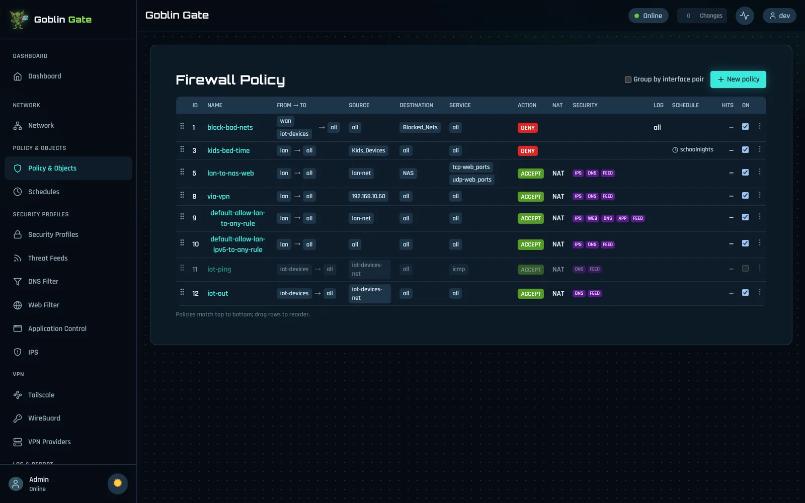
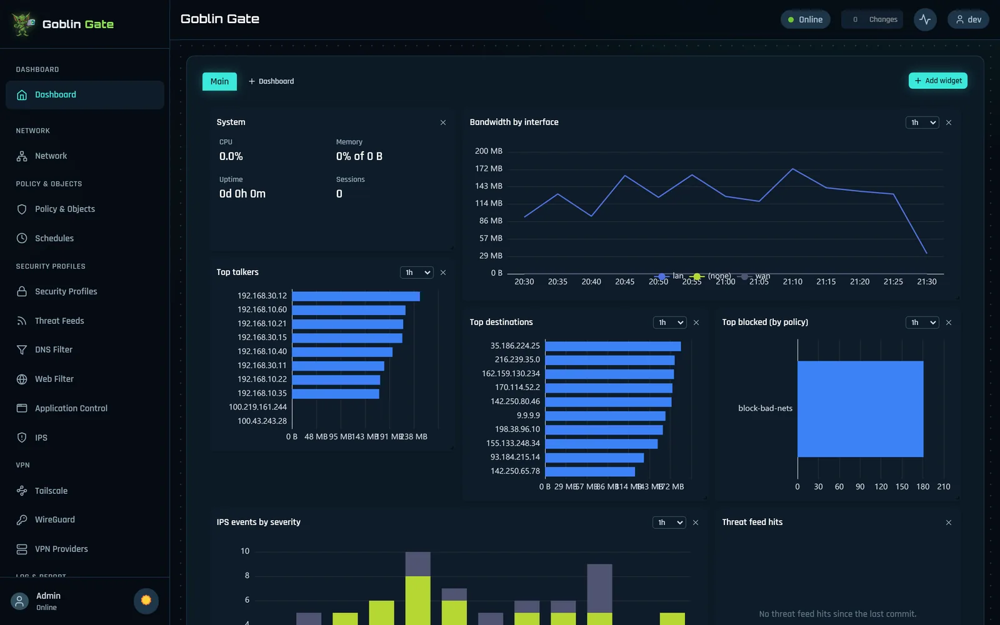
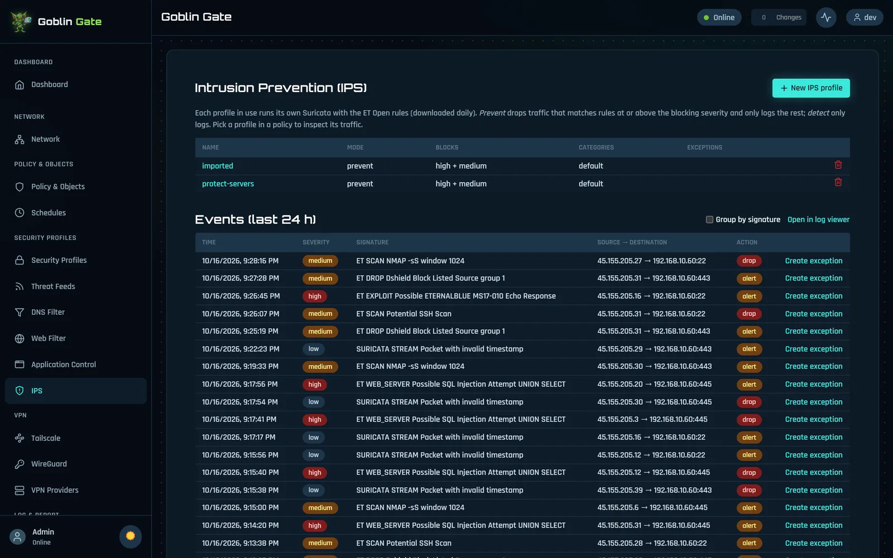
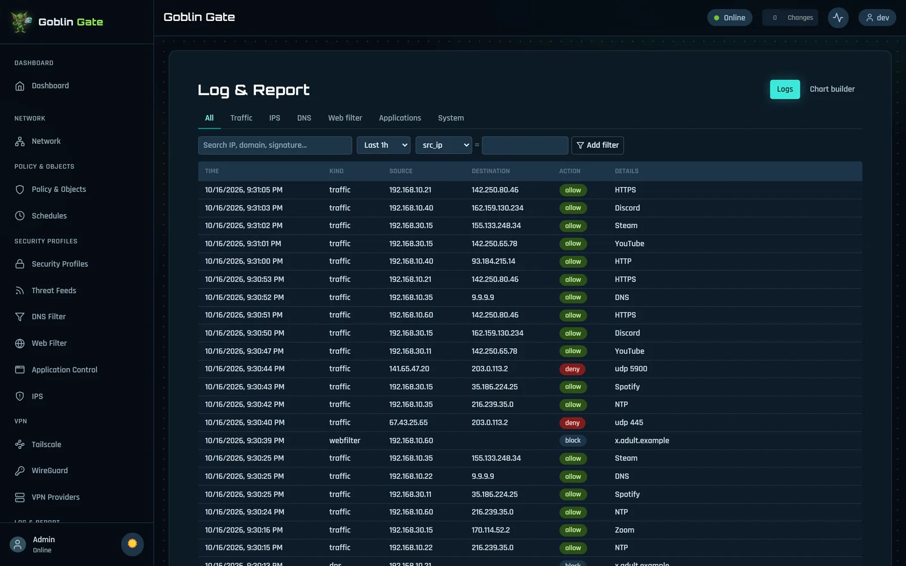
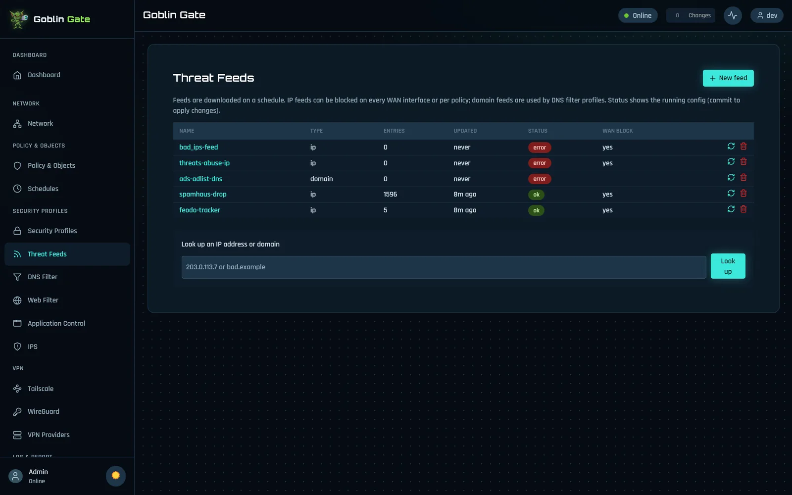

<p align="center">
  
</p>

<h1 align="center">Goblin Gate</h1>

<p align="center"><b>A goblin guards your front door, and you can watch everything it does.</b><br>
<i>An open-source firewall · Debian · nftables · Suricata · Unbound · Kea · WireGuard</i></p>

<p align="center">
  <a href="../../releases"><b>💿 Download the ISO</b></a> ·
  <a href="https://networkgoblin.dev/gate/"><b>🌐 Project page</b></a> ·
  <a href="../../discussions"><b>💬 Discussions</b></a> ·
  <a href="https://networkgoblin.dev/">🧌 Network Goblin Labs</a>
</p>

<p align="center">
  <picture>
    <source media="(prefers-color-scheme: light)" srcset="docs/img/light/policies.webp">
    
  </picture>
</p>

---

## What is this?

Goblin Gate is a firewall for people who want to **understand and automate their network**: homelabbers,
self-hosters, tinkerers, students learning networking, and small offices that want enterprise features without
enterprise licensing.

It's as easy as a home router (a setup wizard gets you online in minutes) and as capable as the expensive
boxes: policies with security profiles, intrusion prevention, web and DNS filtering, threat feeds, multi-WAN,
real dashboards, and a config you can diff, commit and roll back. All of it is open, all of it has an API, and
nothing is hidden. Bring your own x86-64 box or a VM; there's no goblin hardware to buy.

> 🧪 **Beta.** Everything planned for 0.1.0 is in, and the core features pass automated end-to-end tests on
> real VMs. From here on it's about fixing what you find. Try it in a VM or on a spare box first, keep your old
> firewall's config at hand while you switch, and [tell the goblin](../../issues/new/choose) about anything odd.

## The goblin's powers

| | |
|---|---|
| 🧱 **A proper firewall** | Interfaces and VLANs, address and service objects, ordered policies (first match wins, everything else is denied), NAT and port forwards. Schedules limit a policy to certain hours. IPv4 and IPv6 alike. |
| 🌍 **Country rules** | Allow or block by country (GeoIP), in policies or on a port forward: "my Plex server, but only from home". The free DB-IP database downloads and refreshes itself. |
| 🧪 **Ask before you break it** | The policy simulator answers "would this reach that?" without sending a packet, and every denied connection in the log has a "why was this denied?" button. |
| 🧩 **Security profiles per policy** | Build an IPS, web filter, DNS filter or app control profile once, attach it to any policy. The kids' Wi-Fi and your lab VLAN can play by different rules. |
| 📜 **Config you can trust** | Changes pile up in a candidate config. See the diff, commit, and if the change locks you out, it **reverts itself**. Every commit is a revision you can roll back to, named snapshots let you experiment, and every commit can also land in your own git repository (secrets left out). |
| 🛡️ **Intrusion prevention** | Suricata inline with the ET Open rules: bad traffic gets blocked, not just written down. |
| 🚦 **Web and DNS filtering** | Block by category, filter DNS, and decide which apps get through (application control). It also closes the usual DNS-over-HTTPS and private-relay side doors on filtered networks. |
| 🗑️ **Threat feeds and temporary blocks** | Known-bad IP and domain lists, kept fresh automatically. Block any address for a minute or a week; the block lifts itself. |
| 🌐 **IPv6 and multi-WAN** | DHCPv6 with prefix delegation, a /64 per LAN and VLAN. Several internet links with health checks, failover and load sharing, and a gateway per policy (send one VLAN through a VPN provider, with a kill switch). |
| 🏠 **Network services** | DHCP (Kea) and a DNS resolver (Unbound), with local names for DHCP clients, split DNS, DNS rebinding protection, dynamic DNS (Cloudflare, DuckDNS or any update URL), and UPnP if you want it (off by default). |
| 🚀 **Smart queue** | CAKE traffic shaping keeps games and video calls smooth while someone else fills the line. |
| 🔐 **VPN** | WireGuard with a QR code per phone or laptop, and Tailscale. |
| 📊 **Eyes everywhere** | Dashboards built from widgets, logs you can drill into, a chart builder, a device inventory, live traffic per device, packet capture in the browser (download the pcap for Wireshark), and ping, traceroute and DNS lookups from the box itself. |
| 📤 **Plays well with others** | Prometheus metrics with a ready Grafana dashboard, and every log sent on to syslog or Grafana Loki. |
| 🔔 **It tells you things** | Email, webhooks, Discord, ntfy or Telegram when a WAN goes down, an update is ready, and more. |
| 🔄 **Updates that undo themselves** | Signed packages in stable, beta and nightly channels. If an update doesn't come back healthy within 5 minutes, the box quietly reinstalls the previous version. Debian security fixes install nightly on their own. |
| 🔒 **Hardened by default** | Two-factor login, a list of your active sessions, anti-spoofing on every interface, and the IPS, DNS and DHCP services each locked in their own sandbox with only the rights they need. |
| 🧳 **Moving in** | Import your old firewall's XML backup. A report lists every item as converted, approximated or skipped, and nothing goes live until you commit. |
| 🖥️ **Three ways in, one config** | A web UI (light and dark), a REST API for everything, and a CLI. They all edit the same config, so whatever you can click, you can script. |
| 💿 **Installs anywhere** | An offline installer ISO for bare metal (BIOS or UEFI, Secure Boot works), VMware ESXi, Proxmox and VirtualBox. A console menu handles the basics. |

## Plugins: Goblin Sentry and G.O.B.L.I.N.

**Plugins** install as packages (`goblin-gate-plugin-<name>`) and live in a goblin-sized box: each runs as its own
throwaway unprivileged user on a read-only system, capped at one CPU core and 512 MB. A plugin can only make the
API calls you approved under System → Plugins, and every call is audited.

**Goblin Sentry** is the first one (`apt install goblin-gate-plugin-sentry`). It turns IPS alerts into incidents,
adds what the box knows (which way, which of your hosts, seen before?) and answers with a small toolbox:
temporary block, watch, notify, ignore, escalate. Never a shell. By default every block waits for your OK, your
own hosts are never blocked, and each decision keeps a "why".

**G.O.B.L.I.N.** is Sentry's local decision model. It learns from your own answers, runs on the box (no GPU, no
cloud), comes with a report card for every version, is used only after you accept it, and rolls back in one
click. It never blocks on its own.

## A look around

<table>
<tr>
<td><picture><source media="(prefers-color-scheme: light)" srcset="docs/img/light/dashboard.webp"></picture><br><sub>Dashboards from widgets.</sub></td>
<td><picture><source media="(prefers-color-scheme: light)" srcset="docs/img/light/ips.webp"></picture><br><sub>Intrusion prevention, one click to an exception.</sub></td>
</tr>
<tr>
<td><picture><source media="(prefers-color-scheme: light)" srcset="docs/img/light/log.webp"></picture><br><sub>Log &amp; Report: every connection, filterable.</sub></td>
<td><picture><source media="(prefers-color-scheme: light)" srcset="docs/img/light/feeds.webp"></picture><br><sub>Threat feeds, with a lookup box.</sub></td>
</tr>
</table>

<sub>Screenshots follow your GitHub theme: switch to light or dark mode to see the other one. Demo data, not a real network.</sub>

## Summoning a goblin

1. Download the ISO from [Releases](../../releases) (or build it, below).
2. Boot it on a machine or VM with **two network ports** (one for WAN, one for LAN) and pick the disk.
3. On the console menu, assign the ports (and change the LAN address if it clashes with your network).
4. From a computer on the LAN port, open `https://<LAN address>` and run the setup wizard: admin password, WAN,
   LAN, security level, done.

Already running an earlier beta? It updates itself from the beta channel: System → Updates.
The VMware ESXi guide lives in [packaging/README.md](packaging/README.md).

**The user guide is the [wiki](../../wiki)**: every page of the web UI, recipes (isolating a Wi-Fi VLAN,
blocklists that work), moving from pfSense, and troubleshooting.

## Talking to the goblin (CLI)

The `goblin` shell edits the same candidate config as the web UI and the API. Over SSH or the console:

```text
config system interface
  edit lan
    set address 10.0.0.1/24
  next
end
diff                  # what's about to change
commit confirm 5      # apply it, and roll back in 5 minutes unless you confirm
confirm               # still connected? keep it
```

Also there: `show`, `history`, `rollback N`, `discard`, `get system status`, `execute backup` and
`execute restore`. Type `help` for the full list.

## How it works

Everything goes through **goblind**'s REST API, the web UI included. Changes land in a candidate config; a
commit validates it, renders a config file for each engine (nftables, Suricata, Unbound, Kea and friends;
pure functions with golden-file tests), applies them, and rolls back if anything fails. More in
[docs/dev/conventions.md](docs/dev/conventions.md), and plugins in [docs/dev/plugins.md](docs/dev/plugins.md).

## Build from source

Requires Windows with PowerShell, Go 1.26+, Node.js 24+ and Docker Desktop (for the Linux builds and tests).

```powershell
powershell -NoProfile -ExecutionPolicy Bypass -File scripts/verify.ps1      # all checks and tests
powershell -NoProfile -ExecutionPolicy Bypass -File scripts/build-deb.ps1   # the .deb package
powershell -NoProfile -ExecutionPolicy Bypass -File scripts/build-iso.ps1   # the installer ISO
```

Linux and VM tests: `scripts/linux-test.ps1`, `scripts/linux-e2e.ps1`, `scripts/vm-install-test.ps1`,
`scripts/vm-net-test.ps1`.

## What's next

- **Now:** beta testing, daily use as a home firewall, more real hardware, then the first stable release, 0.1.0.
- **In the works:** custom nftables rules for what policies can't express, a CrowdSec bouncer, API tokens
  limited to what a script needs, a live event stream, and global search (Ctrl+K).
- **Later:** a reverse proxy with Let's Encrypt, Home Assistant integration, more plugins.
- **Enterprise for free:** high availability, BGP and OSPF, single sign-on, a captive portal.

The full roadmap lives on the [project page](https://networkgoblin.dev/gate/).

## Join the hoard

Bug reports, ideas and pull requests are all welcome: see [CONTRIBUTING.md](CONTRIBUTING.md). Questions and
wild ideas go in [Discussions](../../discussions).

## License

GPL-3.0-only. See [LICENSE](LICENSE). The core stays free; no feature that's free today gets moved behind a
paywall later.
